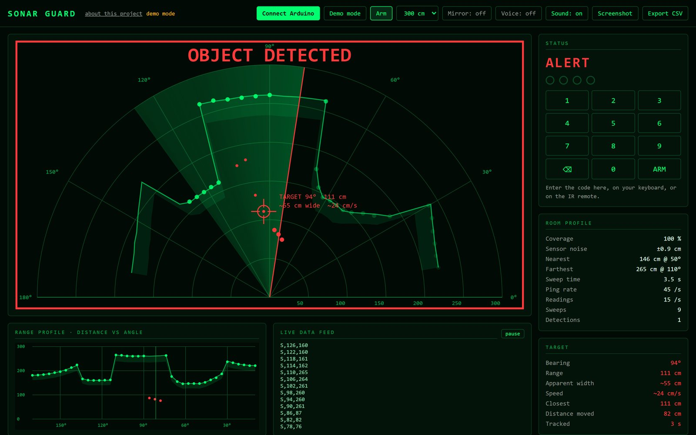

# Sonar Guard

An ultrasonic turret on an Arduino UNO that learns what a room normally looks like, then sweeps it, flags anything new, follows it, and asks for a 4-digit code before the siren goes off.

<!-- TODO(Nate): swap this for media/sonar-guard.gif once the demo video is cut -->


An HC-SR04 sensor on an SG90 servo sweeps back and forth across 160°. The first four sweeps learn where the walls and furniture are, slice by slice. After that, every sweep is compared against what it learned, and anything that shows up closer than normal in two neighboring slices sets off an alert. A single-page dashboard shows the live radar over USB, and it has a Demo mode that simulates a room and an intruder, so you can try it without any hardware.

**Live demo:** [natelevy.tech/demo/sonar-guard](https://natelevy.tech/demo/sonar-guard/?demo). Press Arm, wait for the person to walk in, then type `1234`.

It's the follow-up to my [Scanning Rover](https://github.com/naterjlevy-a11y/scanning-rover), which used the same sensor and servo but only checked three directions.

## Parts and wiring

Everything is from an Elegoo "Super Starter Kit UNO R3". The housing is two Advil boxes: the servo sits upright in one, and the other is taped to the servo horn with the sensor taped to its side.

| Part | Job | Pins |
| --- | --- | --- |
| Arduino UNO R3 | Controller | |
| HC-SR04 ultrasonic sensor | Range finding | Trig 3, Echo 4 |
| SG90 micro servo | Pans the sensor | 13 |
| LCD1602 (parallel, HD44780) | Status display | RS 7, E 8, D4 9, D5 10, D6 11, D7 12. V0 to GND, backlight through 220 Ω |
| IR receiver + NEC remote | Arm and code entry | 2 |
| Passive buzzer | Pings, siren, feedback | 6 |
| Push button | Arm | A1 (internal pull-up) |

## How it works

```
DISARMED   servo parked at 90°, LCD shows "PLAY = arm"
ARMING     5 s exit delay, one beep per second
LEARNING   4 full sweeps; per 4° slice: baseline = median, noise = half the spread
ARMED      continuous sweep 10° to 170°, every slice compared to its baseline
ALERT      object found: sweep narrows to ±30° around it and follows it,
           buzzer pitch rises as it gets closer, 20 s to enter the code
ALARM      no code in 20 s, or 3 wrong codes: two-tone siren until the right code
```

**Detection.** A slice counts as changed when something within 250 cm is closer than its baseline by more than the largest of 20 cm, 3 × that slice's noise, or 10% of the baseline distance. Slices where most learning sweeps got no echo are treated as open space, so any echo there counts. **Two neighboring slices must change in the same sweep** before it triggers. That rule is what cut the false alarms.

**Tracking.** Changed slices inside the tracking window are grouped into clusters, and it follows the cluster closest to the last target. Bearing is the cluster's center, range is its closest slice, and apparent width is `2 × range × tan(span / 2)`. If the target is missing for 3 passes, the sweep widens back to the full field.

**Timing.** Nothing in the loop blocks. The echo pin (pin 4, `PCINT20`) has a pin-change interrupt that timestamps both edges with `micros()`. The loop fires a trigger every 30 ms and picks up the result later, and a missing echo times out after 35 ms. The servo steps 1° every 22 ms (about 3.5 s per sweep), and each reading is tagged with the angle it was fired at minus 2°, because the servo lags its command. Readings are grouped into 41 slices of 4°, and each slice takes the median of up to 6 readings. Sounds go through a small non-blocking `tone()` queue.

## Serial protocol

115200 baud, one line per message. The dashboard's Demo mode emits exactly the same lines.

Arduino to dashboard:

| Line | Meaning |
| --- | --- |
| `READY` | Boot |
| `STATE,<name>` | `DISARMED`, `ARMING`, `LEARNING`, `ARMED`, `ALERT`, `ALARM` |
| `S,<angle>,<cm>` | Finished slice reading (`-1` = no echo) |
| `BASE,<angle>,<cm>,<threshold>` | Learned baseline for one slice |
| `CALSTATS,<coverage%>,<avgNoise×10>,<maxNoise>,<nearAngle>,<nearCm>,<farAngle>,<farCm>,<sweepMs>,<pingHz>` | Room statistics after learning |
| `D,<angle>,<cm>,<widthCm>` | New detection |
| `T,<angle>,<cm>,<widthCm>` | Tracking update |
| `LOST` | Target lost, widening the search |
| `PIN,<n>` | Digits entered so far |
| `WRONG,<tries>` | Wrong code |
| `SESSION,<armedSeconds>,<sweeps>,<detections>,<wrongCodes>` | Sent on disarm |

Dashboard to Arduino: `A` arms, `0`-`9` enter the code, `<` deletes a digit.

## Setup

1. Install the **IRremote** library by Armin Joachimsmeyer (Arduino IDE, Library Manager). The sketch uses its `TinyIRReceiver`.
2. Wire it as in the table. If you change pins, the echo pin is read straight from `PIND` bit 4 with `PCINT20`, so moving it off pin 4 means changing the interrupt setup too. The IR receiver has to stay on pin 2 (INT0).
3. Open `firmware/sonar_guard/sonar_guard.ino` and upload it. The code is `PIN_CODE` near the top (default `1234`).
4. Open `dashboard/index.html` in **Chrome or Edge** (Web Serial doesn't work in Safari or Firefox), click **Connect Arduino** and pick the board's port. Or click **Demo mode** to run it with no hardware. Adding `?demo` to the URL starts Demo mode straight away.

Remote: PLAY arms, `0`-`9` enter the code, `|<<` deletes a digit. The push button also arms it.

## What broke

**The first version kept freezing.** It read the sensor with `pulseIn()` and played beeps with `delay()`, so the Arduino spent most of its time waiting. The IR receiver dropped button presses, which made the code really hard to type in, and the sweep was stop-and-go. The rewrite above is the fix: interrupt-timed echoes, a timer-stepped servo and a queued buzzer.

**Three libraries, two timers.** The Servo library uses Timer1, `tone()` uses Timer2, and the standard IRremote receiver also wants Timer2. `TinyIRReceiver` decodes on an external interrupt (INT0) instead, so it needs no timer. That's why the IR receiver is on pin 2 and the button moved to A1.

**False alarms.** One fixed threshold for the whole room gave false alarms. The learning phase now measures every slice's own noise, the threshold scales with it, and two neighboring slices have to agree.

**The laptop app.** It started as a Python and matplotlib app. The single-file web dashboard replaced it, so there's nothing to install and it doubles as the public demo.

## Limitations

- The HC-SR04's beam is about 15° wide, so objects look wider than they are and corners get rounded off. The reported width overestimates, and the speed on the dashboard is an estimate from successive tracking fixes.
- Soft surfaces and steep angles can swallow the echo, which reads as open space.
- Detection range, false-alarm rate and tracking accuracy haven't been measured on the real turret yet. <!-- TODO(Nate): add numbers from a real session report or CSV export -->

## Next

- A housing designed in CAD and 3D printed, to replace the Advil boxes.
- A second ultrasonic sensor.
- Logging real runs with the CSV export to measure detection range, false alarms and tracking accuracy.

## Files

```
firmware/sonar_guard/sonar_guard.ino   the Arduino sketch
dashboard/index.html                   the dashboard and Demo mode, one file, no dependencies
media/                                 screenshots
```

Built September 2026. MIT license.
